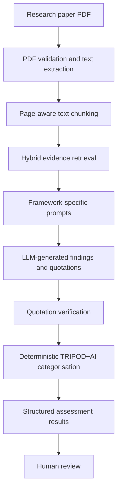
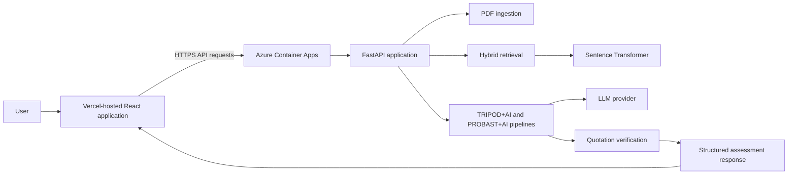

# ModelAudit

**An evidence-linked appraisal assistant for clinical prediction model research.**

[](https://model-audit-alpha.vercel.app/)
[](https://www.python.org/)
[](https://fastapi.tiangolo.com/)
[](https://react.dev/)
[](https://www.typescriptlang.org/)
[](LICENSE)

ModelAudit is an AI-assisted research appraisal application that examines PDF papers describing the development or evaluation of clinical prediction models. It retrieves relevant passages from a paper and proposes structured, evidence-linked findings against selected items from **TRIPOD+AI** and **PROBAST+AI**.

Each finding includes an explanation and, where available, verbatim evidence quotations with page references. Quotation locations are checked against the extracted paper text, while TRIPOD+AI item categories are derived using deterministic rules rather than delegated to the language model.

The objective is to make the appraisal of clinical prediction model research more structured, traceable, and efficient, while keeping human reviewers responsible for the final interpretation.

**Live application:** https://model-audit-alpha.vercel.app/

> **Research preview — v0.1.0**
>
> ModelAudit is a research-support prototype, not a validated clinical or methodological decision system. Its outputs require independent human review. It does not certify prediction models as valid, safe, unbiased, or suitable for clinical deployment.

---

## Contents

- [The problem](#the-problem)
- [What ModelAudit does](#what-modelaudit-does)
- [How it works](#how-it-works)
- [Frameworks implemented](#frameworks-implemented)
- [Technology stack](#technology-stack)
- [Application architecture](#application-architecture)
- [Repository structure](#repository-structure)
- [Getting started](#getting-started)
- [Configuration](#configuration)
- [API reference](#api-reference)
- [Understanding the results](#understanding-the-results)
- [Deployment](#deployment)
- [Testing and development](#testing-and-development)
- [Current limitations](#current-limitations)
- [Future development](#future-development)
- [Licence and attribution](#licence-and-attribution)

---

## The problem

Clinical prediction models are increasingly developed using statistical and machine-learning methods. However, evaluating the research describing these models requires careful examination of how studies were designed, conducted, analyzed, and reported.

Two important questions must be distinguished:

1. **Was the study adequately reported?** TRIPOD+AI provides guidance for reporting studies that develop or evaluate clinical prediction models.
2. **Were the study methods and model evaluations at risk of bias?** PROBAST+AI provides a framework for evaluating methodological quality, risk of bias, and applicability.

These are related but distinct appraisal tasks. A study may report its methods incompletely without necessarily having used inappropriate methods. Conversely, detailed reporting does not automatically establish that a study is methodologically sound.

ModelAudit approaches these tasks independently. It retrieves evidence from the paper, generates structured findings, verifies the locations of proposed quotations, and presents the results for human review.

## What ModelAudit does

### Core capabilities

| Capability | Description |
|---|---|
| PDF ingestion | Accepts text-based research PDFs and extracts their contents page by page. |
| Evidence retrieval | Combines lexical and semantic retrieval to identify passages relevant to individual framework items. |
| TRIPOD+AI appraisal | Evaluates a selected subset of reporting items and derives item-level reporting categories using deterministic rules. |
| PROBAST+AI appraisal | Evaluates eight selected signalling questions from the model-evaluation branch. |
| Evidence-linked findings | Returns explanations, supporting quotations, page references, and quotation-location verification status. |
| Study context | Allows reviewers to supply contextual information that helps resolve conditional appraisal requirements. |
| Provider flexibility | Supports Gemini, Groq, and OpenAI through a common LLM adapter interface. |
| Web interface and API | Provides an interactive research workspace alongside programmatic API access. |

### What it deliberately does not do

ModelAudit does not:

- Generate an overall clinical prediction model quality score.
- Generate official PROBAST+AI domain-level or overall risk-of-bias judgements.
- Automatically establish that a quotation semantically supports a finding.
- Prove that information not retrieved from the main text is absent from the complete paper.
- Establish the external validity or transportability of a prediction model.
- Replace independent methodological appraisal by a qualified reviewer.

---

## How it works

The application follows an evidence-first pipeline. Rather than asking a language model to assess an entire paper in one pass, it retrieves relevant passages for individual appraisal questions.



### 1. Document ingestion

**Module:** `backend/app/ingest.py`

Uploaded PDFs are validated and processed using PyMuPDF.

The ingestion pipeline:

- Validates PDF file content.
- Enforces a maximum file size of 15 MB.
- Enforces a maximum document length of 40 pages.
- Extracts text page by page.
- Splits extracted text into overlapping chunks.
- Retains page references, character offsets, and estimated section headings.

The current implementation uses approximately 1,200-character chunks with a 200-character overlap.

Each document is identified using its SHA-256 file hash.

### 2. Hybrid evidence retrieval

**Module:** `backend/app/retrieval.py`

ModelAudit combines two retrieval approaches:

- **Lexical retrieval:** BM25 identifies passages containing relevant terminology.
- **Semantic retrieval:** Sentence Transformers generates embeddings using `sentence-transformers/all-MiniLM-L6-v2`.

The rankings are combined using Reciprocal Rank Fusion (RRF).

Framework-specific retrieval queries are used to identify relevant passages for each appraisal item or question. Retrieved passages are subsequently ranked and limited to a small evidence set for the corresponding assessment.

### 3. LLM-assisted assessment

**Modules:** `backend/app/llm.py`, `backend/app/probast_llm.py`

The assessment pipeline constructs a separate prompt for each TRIPOD+AI item or PROBAST+AI question.

Prompts incorporate:

- Framework wording.
- Relevant appraisal elements.
- Item-specific instructions and conditional rules.
- Common interpretation errors.
- Retrieved passages from the uploaded paper.

The language model proposes structured findings and supporting quotations in JSON format.

Requests use temperature 0 and JSON response formatting where supported by the provider.

Assessments are processed sequentially to reduce pressure on provider quotas and improve error handling.

### 4. Quotation verification

**Modules:** `backend/app/verify.py`, `backend/app/probast_verify.py`

Proposed evidence quotations are checked against the extracted source text and the page identified by the model.

Verification accommodates conservative differences in Unicode punctuation, whitespace, and line-break hyphenation.

It does not use fuzzy matching to establish quotation validity.

A crucial distinction applies:

**Quotation verification establishes that a quotation can be located in the cited source. It does not establish that the quotation adequately supports the associated finding.**

That semantic judgement remains the reviewer's responsibility.

### 5. Deterministic result derivation

**Modules:** `backend/app/framework.py`, `backend/app/judge.py`

For TRIPOD+AI, the language model does not independently select the final item-level reporting category.

Instead, application logic evaluates the findings for individual elements and derives the category using predefined framework rules.

Conditional requirements are resolved using the study context supplied by the reviewer. When the available context cannot resolve a condition, the application preserves the uncertainty rather than making an unsupported assumption.

PROBAST+AI findings retain their own official response categories and are not converted into TRIPOD+AI reporting categories.

---

## Frameworks implemented

Framework definitions are maintained in JSON files under `backend/framework/`. These files provide the application with the relevant item wording, elements, rules, and retrieval queries.

### 1. TRIPOD+AI — Reporting transparency

**Implemented coverage: 14 selected items.**

The current subset includes:

`3b`, `5a`, `5b`, `6a`, `6b`, `8a`, `9b`, `10`, `11`, `12e`, `16`, `18e`, `18f`, and `23a`.

Each item is decomposed into individual elements, which may be required, optional, or conditional on study characteristics.

The application evaluates the elements and derives an item-level reporting category.

Framework documentation and the rationale for the selected subset are available in:

[`docs/TRIPOD_AI_FRAMEWORK.md`](docs/TRIPOD_AI_FRAMEWORK.md)

### 2. PROBAST+AI — Methodological appraisal

**Implemented coverage: eight signalling questions from the model-evaluation branch.**

| ID | Domain | Signalling question |
|---|---|---|
| PE-1.3 | D1 — Participants | Did the inclusions and exclusions of study participants result in a representative dataset? |
| PE-2.4 | D2 — Predictors | Were the predictors included in the model available at the time the model was intended to be used? |
| PE-3.1 | D3 — Outcome | Were outcomes defined and assessed appropriately? |
| PE-4.1 | D4 — Analysis | Was model evaluation based on only apparent performance avoided? |
| PE-4.2 | D4 — Analysis | Was there evidence that the sample size was reasonable? |
| PE-4.3 | D4 — Analysis | Were participants with missing or censored data handled appropriately in the analysis? |
| PE-4.5 | D4 — Analysis | If data splitting was done to create training and test datasets, was there evidence that data leakage was avoided? |
| PE-4.7 | D4 — Analysis | Was the predictive performance of the model evaluated appropriately, for example calibration, discrimination, and net benefit? |

The implementation covers selected questions only. It does not implement the complete PROBAST+AI tool or its development branch.

Consequently, the application does not generate official domain-level or overall risk-of-bias judgements.

---

## Technology stack

| Layer | Technologies |
|---|---|
| Backend | Python, FastAPI, Pydantic |
| PDF processing | PyMuPDF |
| Lexical retrieval | BM25 |
| Semantic retrieval | Sentence Transformers, `all-MiniLM-L6-v2` |
| LLM integration | Gemini, Groq, OpenAI-compatible API adapter |
| Frontend | React, TypeScript, Vite |
| Testing | Pytest |
| Code quality | Ruff, Oxlint |
| Containerisation | Docker |
| Backend hosting | Microsoft Azure Container Apps |
| Frontend hosting | Vercel |
| Container registry | Azure Container Registry |
| Build automation | GitHub Actions |

---

## Application architecture

ModelAudit separates the user interface from the assessment backend.



### Frontend

The React application provides the research appraisal workspace, including:

- PDF selection and upload.
- Framework selection.
- Study-context inputs.
- Assessment execution.
- Review of structured findings and evidence references.

### Backend

The FastAPI application handles document processing, retrieval, LLM orchestration, quotation verification, and assessment response generation.

### Deployment

The current public deployment uses:

- **Vercel** for the frontend.
- **Azure Container Apps** for the backend API.
- **Azure Container Registry** for storing the backend Docker image.
- **GitHub Actions** for building and publishing container images.

The frontend communicates with the backend through the `VITE_API_BASE_URL` build-time environment variable. The backend uses CORS configuration to allow the deployed frontend origin.

---

## Repository structure

```text
ModelAudit/
│
├── backend/
│   ├── app/
│   │   ├── main.py
│   │   ├── config.py
│   │   ├── ingest.py
│   │   ├── retrieval.py
│   │   ├── schemas.py
│   │   ├── framework.py
│   │   ├── audit.py
│   │   ├── judge.py
│   │   ├── verify.py
│   │   ├── llm.py
│   │   └── probast_*.py
│   │
│   ├── framework/
│   │   ├── tripod_ai_subset.json
│   │   └── probast_ai_subset.json
│   │
│   ├── scripts/
│   │   ├── diagnose_retrieval.py
│   │   └── groq_smoke.py
│   │
│   └── tests/
│
├── frontend/
│   ├── public/
│   ├── src/
│   ├── index.html
│   ├── package.json
│   └── vite.config.ts
│
├── docs/
│   └── TRIPOD_AI_FRAMEWORK.md
│
├── .github/
│   └── workflows/
│       └── build-image.yml
│
├── Dockerfile
├── requirements.txt
├── pyproject.toml
├── .env.example
├── .gitignore
└── LICENSE
```

---

## Getting started

### Prerequisites

- Python 3.11 or newer.
- Node.js and npm.
- An API key from a supported LLM provider for assessment functionality.
- Internet access on first use to download the sentence-transformer model.

Document upload and evidence retrieval do not require an LLM API key. The assessment endpoints do.

### 1. Clone the repository

```bash
git clone https://github.com/fawaz-b/ModelAudit.git
cd ModelAudit
```

### 2. Set up the backend

Create and activate a virtual environment:

```bash
python -m venv .venv
```

Windows PowerShell:

```powershell
.venv\Scripts\Activate.ps1
```

Linux/macOS:

```bash
source .venv/bin/activate
```

Install dependencies:

```bash
pip install -r requirements.txt
```

Create the environment configuration file:

```bash
cp .env.example .env
```

On Windows PowerShell:

```powershell
Copy-Item .env.example .env
```

Configure the LLM provider and API key in `.env`.

Start the backend from the `backend` directory:

```bash
cd backend
uvicorn app.main:app --reload
```

The backend will be available at:

`http://127.0.0.1:8000`

Interactive API documentation:

`http://127.0.0.1:8000/docs`

### 3. Set up the frontend

Open a second terminal from the repository root:

```bash
cd frontend
npm install
npm run dev
```

The frontend development server runs at:

`http://localhost:5173`

By default, the frontend sends requests to `http://localhost:8000`. Start the backend before using the application.

---

## Configuration

### Backend environment variables

The backend reads configuration from environment variables and the project-root `.env` file.

| Variable | Description |
|---|---|
| `ENVIRONMENT` | Application environment label. |
| `LLM_PROVIDER` | Registered provider: `gemini`, `groq`, or `openai`. |
| `LLM_MODEL` | Model identifier used by the selected provider. |
| `LLM_BASE_URL` | OpenAI-compatible API base URL. |
| `LLM_API_KEY` | API key for the selected provider. |
| `LLM_TIMEOUT_SECONDS` | Per-request timeout. Default: 90 seconds. |
| `LLM_MAX_RETRIES` | Maximum retries for transient provider errors. Default: 3. |
| `CORS_ORIGINS` | Comma-separated list of additional frontend origins permitted to access the API. |

The application already allows:

- `http://localhost:5173`
- `http://127.0.0.1:5173`

Additional production origins should be configured using `CORS_ORIGINS`.

**Provider configuration:** Set `LLM_PROVIDER`, `LLM_MODEL`, `LLM_BASE_URL`, and `LLM_API_KEY` consistently for the same provider. Model identifiers and API compatibility should be checked against the provider's current documentation.

### Frontend environment variables

| Variable | Description |
|---|---|
| `VITE_API_BASE_URL` | Base URL of the backend API. Defaults to `http://localhost:8000`. |

For a deployed frontend, set `VITE_API_BASE_URL` to the public backend URL before building the application.

---

## API reference

The backend exposes the following endpoints:

| Method | Endpoint | Description |
|---|---|---|
| `GET` | `/` | Application information. |
| `GET` | `/health` | Health check. |
| `POST` | `/documents/upload` | Upload and process a research PDF. |
| `POST` | `/documents/{document_id}/retrieve` | Retrieve relevant evidence passages. |
| `POST` | `/documents/{document_id}/assess` | Run the TRIPOD+AI assessment. |
| `POST` | `/documents/{document_id}/assess/probast` | Run the PROBAST+AI evaluation subset. |

Full interactive documentation is available at `/docs` when the backend is running.

### 1. Upload a paper

```bash
curl -X POST \
  -F "file=@paper.pdf" \
  http://127.0.0.1:8000/documents/upload
```

The response includes the document identifier, page count, chunk count, and extracted document information.

### 2. Retrieve evidence

```bash
curl -X POST \
  http://127.0.0.1:8000/documents/DOCUMENT_ID/retrieve \
  -H "Content-Type: application/json" \
  -d '{
    "query": "How were missing data handled?",
    "top_k": 5
  }'
```

Retrieved passages include information such as their page references, text, ranking, and retrieval score.

### 3. Run TRIPOD+AI

```bash
curl -X POST \
  http://127.0.0.1:8000/documents/DOCUMENT_ID/assess \
  -H "Content-Type: application/json" \
  -d '{
    "study_type": "prognostic",
    "has_separate_evaluation_dataset": true,
    "imputation_used": true,
    "data_stated_available": false,
    "code_stated_available": false
  }'
```

The request accepts structured study-context fields. These help determine whether conditional checklist elements apply.

Examples include:

- Study type.
- Availability of a separate evaluation dataset.
- Use of synthetic data.
- Whether imputation was performed.
- Whether multiple models were evaluated.
- Data and code availability.
- Whether subgroup performance was evaluated or reported.

Uncertain context should be left unresolved rather than guessed.

### 4. Run PROBAST+AI

```bash
curl -X POST \
  http://127.0.0.1:8000/documents/DOCUMENT_ID/assess/probast \
  -H "Content-Type: application/json" \
  -d '{
    "document_id": "DOCUMENT_ID",
    "model_identifier": "Prediction model described in the paper",
    "context": {
      "study_type": "evaluation",
      "evaluation_components": ["internal", "external"],
      "validation_method": "training_test_split",
      "has_training_test_split": true,
      "evaluation_dataset_independent": true,
      "picots": {
        "population": "Adults admitted to hospital",
        "outcome": "In-hospital mortality",
        "setting": "Tertiary hospitals",
        "intended_use": "Clinical risk assessment"
      }
    }
  }'
```

The PROBAST+AI request supports study types including `development`, `evaluation`, `both`, and `unclear`.

Evaluation components include `apparent`, `internal`, `external`, and `unspecified`.

The response contains question-level findings, explanations, evidence references, and limitations.

---

## Understanding the results

### TRIPOD+AI reporting categories

| Category | Interpretation |
|---|---|
| `reported` | Required applicable elements are supported by verified evidence, or an explicit author statement establishes unavailability. |
| `partially_reported` | Some required elements are supported, while others are missing, vague, or unverified. |
| `author_stated_unavailable` | The authors explicitly state that information is unavailable, unknown, or not applicable. |
| `not_found_in_main_text` | Supporting information was not identified in the retrieved main-text evidence. |
| `unclear` | Evidence is ambiguous, conflicting, unverified, or insufficient to resolve applicability. |
| `not_applicable` | The item does not apply under the framework rules. |
| `not_assessed` | The item was not evaluated, for example because of a provider quota or execution failure. |

A `not_found_in_main_text` result should not be interpreted as proof that information is absent from the complete paper, supplementary material, or protocol.

Likewise, a `reported` category does not establish methodological quality.

### PROBAST+AI responses

The implemented questions use the PROBAST+AI response vocabulary:

- `yes`
- `probably_yes`
- `probably_no`
- `no`
- `no_information`
- `not_applicable`

The application may also return `not_assessed` to indicate that a question was not evaluated.

A `no` response to an individual signalling question does not automatically establish that its entire domain is at high risk of bias.

**Important:** ModelAudit currently does not generate official domain-level or overall PROBAST+AI risk-of-bias judgements because the implemented question set is incomplete.

### Evidence verification

Evidence references have a verification status indicating whether the proposed quotation can be located in the cited source.

This is a source-location check, not a semantic entailment assessment.

Reviewers must independently determine whether each quotation supports the associated explanation and category.

---

## Deployment

ModelAudit is deployed as a separate frontend and backend application.

### Frontend — Vercel

The frontend is built using Vite and deployed on Vercel.

Production configuration:

- Root directory: `frontend`
- Framework preset: Vite
- Install command: `npm install`
- Build command: `npm run build`
- Output directory: `dist`
- Environment variable: `VITE_API_BASE_URL`

Live application:

https://model-audit-alpha.vercel.app/

### Backend — Azure Container Apps

The backend is packaged using the root `Dockerfile` and deployed to Azure Container Apps.

The container:

- Uses Python 3.11.
- Installs dependencies from `requirements.txt`.
- Copies the backend application and framework definitions.
- Runs Uvicorn on port `8000`.

### Container image build — GitHub Actions

The workflow in `.github/workflows/build-image.yml` builds and pushes the backend image to Azure Container Registry.

The workflow uses repository secrets for registry authentication:

- `ACR_USERNAME`
- `ACR_PASSWORD`

The image is built and published on qualifying pushes to the `main` branch and can also be triggered manually.

The image-build workflow is separate from application deployment and does not, by itself, establish that the deployed container has been updated.

### Deployment considerations

Before exposing a deployment publicly:

- Store API keys in the hosting platform's secret-management facility.
- Do not commit `.env` files or credentials.
- Configure the backend's CORS origins.
- Keep the backend to a single replica while document state is held in process memory.
- Monitor LLM provider quotas and execution time.
- Avoid uploading identifiable patient information or confidential documents.

---

## Testing and development

### Automated tests

The backend has a test suite covering:

- API behaviour.
- PDF ingestion.
- Evidence retrieval.
- Quotation verification.
- TRIPOD+AI framework loading and category derivation.
- PROBAST+AI framework loading and assessment.
- LLM provider handling and resilience.

The project test suite contains 92 tests in the documented baseline. Tests use controlled or mocked dependencies and do not require a live LLM API key.

Run the tests from the backend directory:

```bash
cd backend
pytest
```

### Code quality

Ruff is used for Python linting and formatting.

```bash
ruff check .
ruff format .
```

The frontend uses Oxlint:

```bash
cd frontend
npm run lint
```

### Helper scripts

From the `backend` directory:

```bash
python -m scripts.diagnose_retrieval path/to/paper.pdf --top-k 10
```

This compares lexical, semantic, and hybrid retrieval results.

To check the configured Groq provider:

```bash
python -m scripts.groq_smoke
```

### Adding an LLM provider

The provider integration is designed to be extensible.

Providers supporting the OpenAI chat-completions format can be integrated through the existing adapter registry. Providers requiring a different request format can implement the `LLMAdapter` interface and be registered without rewriting the assessment orchestration.

---

## Current limitations

ModelAudit is an early research prototype. Its current limitations are important to understanding what its outputs can and cannot establish.

### 1. Partial framework coverage

- Only 14 selected TRIPOD+AI items are implemented.
- Only eight PROBAST+AI model-evaluation signalling questions are implemented.
- The PROBAST+AI development branch is not implemented.
- Official PROBAST+AI domain-level and overall judgements are not generated.

### 2. No persistent storage

Uploaded documents, indexes, and assessment results are held in application memory.

A backend restart clears this state. Documents must be uploaded again.

### 3. No authentication or multi-user workflow

The current application does not implement user authentication, role-based access control, or a persistent multi-user reviewer workflow.

There is also no rate limiting. Public access to the backend may therefore result in unintended LLM usage and provider-quota consumption.

### 4. No reviewer decision controls or audit trail

The interface presents findings for review but does not yet provide a complete workflow for accepting, amending, or rejecting findings.

Reviewer decisions are not persisted in an append-only audit trail.

### 5. Text-based PDFs only

Scanned PDFs requiring OCR are not supported.

Tables, figures, and other non-textual content may not be adequately represented by text extraction. Supplementary documents are not independently ingested.

### 6. Retrieval-bounded evidence

The language model receives a limited set of retrieved passages rather than the entire paper for every question.

Relevant information may therefore be missed. In particular, absence claims require full-text human verification.

### 7. Quotation verification is not semantic verification

The system checks whether a quotation exists at its cited location. It does not formally establish whether that quotation logically entails the associated finding.

### 8. No formal external validation

The application has not undergone a formal validation study measuring its agreement with expert human reviewers.

Its accuracy, reliability, and generalizability across research papers and model types have not been established.

### 9. Third-party LLM processing

Paper excerpts are transmitted to the configured LLM provider for assessment. Users should consider confidentiality, data protection, and provider terms before uploading documents.

### 10. Execution time and provider quotas

Assessments involve multiple sequential LLM requests and may take several minutes. Provider rate limits, quota restrictions, and hosting-platform timeouts can interrupt execution.

---

## Future development

Potential development priorities include:

- Expanding coverage of TRIPOD+AI and PROBAST+AI.
- Persistent document and assessment storage.
- Reviewer decision controls and an auditable review history.
- Export of structured assessments in JSON, CSV, HTML, and PDF formats.
- Background assessment execution with progress reporting.
- Authentication and access control.
- Improved handling of supplementary files, tables, and scanned documents.
- A contextual applicability and transportability assessment layer.
- Benchmarking against manually appraised papers to evaluate extraction accuracy, evidence-link correctness, and agreement with expert reviewers.

These are development directions, not claims about currently implemented functionality.

---

## Licence and attribution

### ModelAudit

The original application code is released under the [MIT License](LICENSE).

### TRIPOD+AI

Collins GS, Moons KGM, Dhiman P, et al. **TRIPOD+AI statement: updated guidance for reporting clinical prediction models that use regression or machine learning methods.** *BMJ*. 2024;385:e078378.

https://www.bmj.com/content/385/bmj-2023-078378

The TRIPOD+AI publication is distributed under a [Creative Commons Attribution 4.0 International licence (CC BY 4.0)](https://creativecommons.org/licenses/by/4.0/).

The framework implementation incorporates relevant checklist wording and paraphrased explanatory guidance. See [`docs/TRIPOD_AI_FRAMEWORK.md`](docs/TRIPOD_AI_FRAMEWORK.md) for additional documentation.

### PROBAST+AI

Moons KGM, Damen JAA, Kaul T, et al. **PROBAST+AI: an updated quality, risk of bias, and applicability assessment tool for prediction models using regression or artificial intelligence methods.** *BMJ*. 2025;388:e082505.

https://www.bmj.com/content/388/bmj-2024-082505

The PROBAST+AI publication is distributed under a [Creative Commons Attribution-NonCommercial 4.0 International licence (CC BY-NC 4.0)](https://creativecommons.org/licenses/by-nc/4.0/).

The non-commercial restriction applies to material incorporated from this source. Anyone considering commercial use should review the applicable licence terms.

ModelAudit is an independent project. It is not affiliated with, endorsed by, or officially maintained by the TRIPOD or PROBAST working groups.

---

**Built for more transparent, traceable, and reproducible appraisal of clinical prediction model research.**
